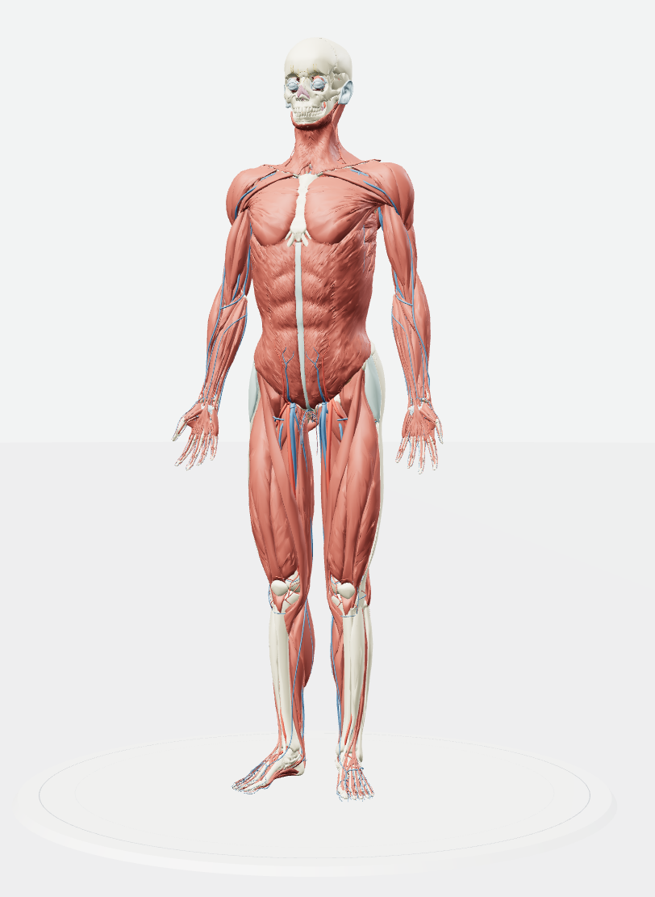

# 人体图谱 · Human Atlas（中文版）

一个运行在浏览器里的**交互式 3D 人体解剖图谱**。可以将成年人参考人体拆解为可单独点选的结构件，按解剖系统开关图层，搜索每一个命名结构，并阅读它的功能说明——**默认中文，可切换英文**。

基于 [slorksmo/Human-Atlas](https://github.com/slorksmo/Human-Atlas)（MIT）深度中文化，并新增 HTTPS 认证网关与容器化部署。英文原版说明见 [README.en.md](README.en.md)。

<p align="center"></p>

## 功能特性

- **中英双语**：界面 100% 中文化，一键切换；解剖名词 72%+ 中文（其余回退英文显示，与原版阿语策略一致）
- **两具参考人体**：男性（BodyParts3D 4.0，2,234 结构件 / 3,432 命名概念）与女性（人体参考图谱 v1.10，964 结构件 + 借用骨骼 + 供体肌肉），头部下拉切换
- **每个网格都可点选**：点按结构即隔离显示并阅读说明（约 256 个重点结构提供中文描述，其余显示所属系统说明）
- **系统图层**：19 个解剖系统独立开关，骨骼/器官快捷预设
- **爆炸分解视图**：0%（已合并）→ 100%（逐件清单）；滑杆 + **可直接键入百分比** + 两端快捷切换按钮
- **灵活的视角操作**：空白处拖拽环绕、**按住人体拖拽平移**、滚轮/捏合缩放、四向预设视角、自动旋转、一键重置
- **搜索**：支持中文或英文结构名、EDB/FMA 标识符，实时过滤

## 快速开始（Docker，推荐）

```sh
docker compose up -d --build
```

打开 **https://localhost:3443**（自签证书，浏览器提示后选择继续访问即可）。

**默认账号：`admin` / `admin@2026` —— 登录后请立即修改密码！**

## 本地开发

需要 Node.js ≥ 22.13：

```sh
npm ci
npm run dev        # http://localhost:3016（无认证，仅调试用）
npm run build      # 产出静态站点到 dist/
```

## HTTPS + 认证说明

访问由内置认证网关（`server/server.mjs`）提供：所有页面与模型资源都要求登录，未登录访问自动跳转登录页。

| 项 | 说明 |
| --- | --- |
| 默认账号 | `admin` / `admin@2026`（首次启动自动播种） |
| 修改密码 | 登录后点击顶栏 🔑 图标，或直接访问 `/change-password`；需验证当前密码，新密码至少 8 位 |
| 口令存储 | `data/users.json`（scrypt 加盐哈希，绝不存明文） |
| 会话 | HttpOnly Cookie，12 小时有效；修改密码后全部会话失效 |
| 证书 | 首次启动自动生成自签证书；正式证书放入 `data/certs/cert.pem` 与 `key.pem` 后重启即用 |
| 重置账号 | 删除 `data/users.json` 后重启容器，恢复默认 admin/admin@2026 |

环境变量（均可在 docker-compose.yml 中调整）：`PORT`（默认 3443）、`DATA_DIR`（默认 /data）、`DIST_DIR`、`CERT_DIR`。

## 解剖学术语中文化管线

`app/terms-zh.json`（概念名 → 中文）由三路合并生成，人工校对永远优先：

1. **人工复核表** `scripts/chinese-review.json`（262 条常用结构名）
2. **Wikidata 精确连接**：每个概念携带 FMA 解剖学标识符，经 P1402 属性取 zh 标签（`scripts/fetch-chinese-terms.mjs`）
3. **构词法合成**：BodyParts3D 命名高度语法化（如 "Wall of right atrium"），用词干词典（488 词干 + 351 标准短语）按中文语序组合（`scripts/compose-chinese-terms.mjs`）

重新生成：`node scripts/fetch-chinese-terms.mjs && node scripts/compose-chinese-terms.mjs`。未覆盖的名称回退英文显示——错误的解剖名词比英文更糟。

## 项目结构

```
app/            界面与 3D 场景（i18n、解剖数据、合成术语、场景渲染）
components/     shadcn/ui 组件
scripts/        术语管线与模型处理脚本
server/         HTTPS 认证网关（Express + 自签 TLS + 会话管理）
web/            Vite 入口
public/models/  两具参考人体模型（约 182MB）
Dockerfile      多阶段构建（前端构建 → 认证网关运行时）
```

## 数据来源与许可

| 数据 | 来源 | 许可 |
| --- | --- | --- |
| 男性参考人体 | BodyParts3D 4.0，© The Database Center for Life Science | CC BY 4.0 |
| 女性参考人体 | 3D Reference Organ Set for Female v1.10（HuBMAP 人体参考图谱），基于美国国家医学图书馆可见人体数据集 | CC BY 4.0 |
| 中文名称 | Wikidata 标签与别名 | CC0 |
| 代码 | 上游 slorksmo/Human-Atlas 及本仓库改动 | MIT |

本图谱是解剖学教学参考，不是诊断或手术工具。
